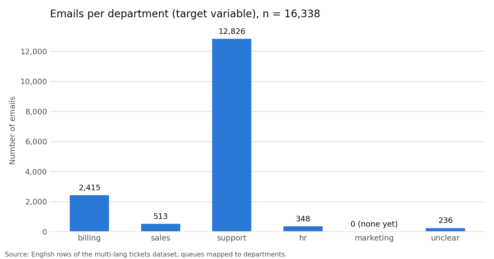

# Email Automation Pipeline

**An AI automation system that does a company's repetitive email work: it filters spam, routes each message to the right department, and answers what it can, all on local Ollama models.**

## Project sentence

**Start-ups and small companies** suffer from **expensive employee time being
spent on small, repetitive jobs like sorting, forwarding and answering email**,
and we'll build **an AI automation system that filters, routes and responds to
company email** using **local AI models (Ollama) orchestrated with LangGraph
and LangChain**.

## Target audience

- **Who pays for it:** founders and managers of start-ups and small companies (roughly 5–50 employees). People are their biggest expense, and they can't afford staff whose day is spent on routine email work.
- **Who uses it every day:** operations, support, sales, billing, HR and marketing employees who currently triage a shared inbox by hand. The system takes routine email off their plate and leaves them the complex cases.
- **Why local models fit them:** these companies want automation without sending sensitive business email to external AI services or paying per-request API costs.

## The problem

In production environments, many small, repetitive jobs need either constant human attention or rigid deterministic code.
People are the most expensive line item in a start-up, and a large share of their time goes to this routine work instead of the complex work only they can do.
Hand-written rules break as soon as the input varies, and hiring more people doesn't scale.
AI models can handle the variability, and running them locally (Ollama) keeps company data in-house and inference costs near zero.
We start with email: it's high-volume, noisy and repetitive, and it touches every department.

## What we're building

We're building a **fake company** with its own mail server and departments
(billing, sales, support, HR, marketing). It receives a constant stream of
email, some of it noise and some of it relevant. The automation system:

1. **Filters**: detects spam and noise and moves it to the spam folder.
2. **Classifies and routes**: recognizes what each email is about and forwards it to the right department.
3. **Responds and investigates**: drafts or sends replies to the emails it can handle, and gathers context on the rest before a human sees them.
4. **Escalates**: flags anything it isn't confident about for human review.

The flow is a LangGraph graph whose nodes call local models through
LangChain. It is model-agnostic, so we can swap in and compare different
models pulled from Ollama. Every run is traced in LangSmith / Langfuse for
debugging and evaluation.

## Persona + scenario

**Dana, operations manager at a 20-person start-up.** Every morning the
shared inbox has about 80 new emails. Before the system, two people spent half
their day reading, forwarding and answering routine questions. Now, when Dana
opens the shared inbox, spam is already gone and department emails are already in
the right mailboxes. Routine questions ("Where's my invoice?") have been
answered. Dana only reviews the handful of emails the system flagged as
unclear, and both people are free for work that actually needs them.

## Data source

**Our data is email, not a fixed table.** The system's input is real email
arriving at our local mail server (Postfix + Dovecot). The server has a triage
inbox, five department mailboxes and a spam folder. Emails don't share a fixed
row/column format: each one is an unstructured MIME message. The pipeline
parses every message into the same set of fields:

| Field | Notes |
|---|---|
| `from`, `to`, `date` | Always present in the headers |
| `subject` | Can be empty |
| `body` | Plain text, HTML-only, or empty (attachment-only messages) |
| `attachments` | Zero or more, any file type |
| `headers` | Reply chains, mailing-list and auto-generated markers |

Handling messy input (empty subjects, HTML-only bodies, attachment-only mail,
forwarded threads) is part of what the system has to do.

**Where the test email comes from:** we fill the fake company's mailboxes
with public Kaggle datasets, which we send into the mail server as real
messages, plus synthetic emails generated for the fake company. The cleaned
dataset is in the repo: [`data/emails_clean.csv`](data/emails_clean.csv)
(34,801 rows). Sources and download steps are in
[`data/README.md`](data/README.md), and it is rebuilt with
`python scripts/build_dataset.py`.

### Data Card

| Field | |
|---|---|
| **Source and link** | Three Kaggle datasets, all synthetic or generated text (no real company mail, no time period: the emails have no dates). [Customer IT Support - Ticket Dataset](https://www.kaggle.com/datasets/tobiasbueck/multilingual-customer-support-tickets) by Tobias Bueck (2024–2025, 16,338 rows used) gives the department labels. [Spam Email Detection Dataset](https://www.kaggle.com/datasets/ssssws/spam-email-detection-dataset-clean-and-ml-ready) by Thanh Nhan Nguyen (2026, 10,000 rows) gives the spam labels. [Customer Support Ticket Dataset](https://www.kaggle.com/datasets/suraj520/customer-support-ticket-dataset) by Suraj (2023, 8,463 rows) is unlabelled extra mail. |
| **Size and format** | One CSV, 34,801 rows × 8 columns (`id`, `source`, `from`, `subject`, `body`, `spam`, `department`, `reply`), about 17 MB. Column reference: [Combined Dataset](docs/data/combined-dataset.md). |
| **Target variable** | **`department`**: categorical, 6 classes (`billing`, `sales`, `support`, `hr`, `marketing`, `unclear`), labelled for 16,338 rows. **`spam`**: binary 0/1, all 34,801 rows (3,995 spam). |
| **Missing values and problems** | Empty `subject` in 2,607 rows (kept), empty `department` in 18,463 rows (= no label, excluded from routing scores), empty `reply` outside the IT tickets. 6 duplicates removed. 366 support-ticket bodies (1.1%) still contain cut-off generator fragments (kept, flagged). Some labels look wrong (e.g. integration questions labelled `billing`). Details in the cleaning table below. |
| **License and bias** | CC BY 4.0 (IT tickets), CC BY-SA 4.0 (spam), CC0 (support tickets): use is allowed with attribution, and the spam rows must stay under CC BY-SA. **Not represented:** real company mail, languages other than English, HTML email and attachments, marketing email (0 rows). `support` is 78.5% of labelled rows, so small departments are under-represented. The spam text is random filler words and much easier to spot than real spam. |

### Cleaning decisions

| Issue | What we found | What we did | Why |
|---|---|---|---|
| **Missing values** | 2,607 empty subjects | Kept as empty strings, not filled | Real email has empty subjects; the pipeline must cope |
| | No department for the spam and support-ticket rows (18,463) | Marked as empty = "no label", not filled and not `unclear` | Filling would invent labels; `unclear` is a real class |
| | No reply outside the IT tickets | Left empty | Only used to judge auto-replies where a reference exists |
| | No sender in the IT tickets | All senders replaced (see below) | |
| **Duplicates** | 6 identical (subject, body) pairs | Removed | The same email shouldn't count twice |
| **Column types** | `\n` stored as text in 740 bodies; labels as text/int | Converted to real newlines; `spam` and `id` are int, the rest strings | Emails must display correctly; labels must be comparable |
| **Near duplicates** | 121 rows share a body with another row but have a different subject (generated support tickets) | Kept | Different emails that share a template sentence, like real customers |
| **Wrong values** | 366 support-ticket bodies (1.1%) contain cut-off placeholders (`{product_p`) or pasted code/JSON from the dataset's generator | Kept and flagged | All in the unlabelled source, so no label is affected; real mail also has pasted junk. Revisit when synthetic mail replaces this source |
| **Outliers** | Bodies from 6 to 1,141 characters; 97 under 30 chars ("Facing some problems"), 91 over 709 | Kept all | They are genuine short and long emails, not errors |
| **Wrong language** | 12,249 German tickets | Removed | Company and prompts are English |
| **Random labels** | `Ticket Type` in the support tickets doesn't depend on the text | Label dropped, text kept unlabelled | Training on it would mean learning noise |
| **Template leftovers** | ~300 placeholder spellings (`{product_purchased}`, `{error_message}`…) in the support tickets | Filled with the ticket's product or a realistic error; others removed | Placeholders aren't real email text |
| **Label leakage** | Sender domain and row order revealed the source (and so the labels) | One shared pool of made-up senders; rows shuffled (fixed seed) | A model must read the email, not the sender or position |
| **Real people's data** | Two HR files with real addresses, names, LinkedIn URLs | Not used, not committed | Privacy |

Full step-by-step log: [Data Preparation](docs/data/data-preparation.md).

### 3 things we fixed, and why

1. **Dropped the German rows (12,249 of 28,587 tickets).** Our fake company and our model prompts are in English, and mixing languages would make the comparison between Ollama models unfair.
2. **Dropped the labels of the customer-support-tickets dataset.** Its `Ticket Type` doesn't depend on the ticket at all (a "billing inquiry" is as likely to be about a broken screen as anything else), so training on it would mean learning noise. We kept the text as unlabelled mail and filled in the template placeholders it was generated from: `{product_purchased}` in every description, plus about 300 other spellings in 12% of them (`{Product_id}`, `{{item.price}}`, `{error_message}`…), replaced with the ticket's product or a realistic error message.
3. **Kept real people's data out of the repo.** The two HR files contain only real addresses, names and LinkedIn URLs, and no email text. They stay local, and every sender in the public dataset is made up.

### Target variable: department



The 10 ticket queues are mapped to our departments (for example Technical,
Product and IT Support → `support`; Billing and Returns → `billing`; General
Inquiry → `unclear`).

**How the labels were made:** the department label is the original ticket
queue, mapped by a fixed table in `scripts/build_dataset.py`. Both the ticket
text and its queue come from a synthetic generator, and the EDA shows the text
was likely written *from* the queue (billing words never appear outside
billing). A model can partly learn the generator's word choice, so the scores
on this data are an upper bound for real mail. The spam label comes from the
spam dataset's own (synthetic) generator in the same way.

## EDA notebook, insight and baseline

[`eda.ipynb`](eda.ipynb) checks the cleaned data for signal with four
questions (column types, data quality, distributions, correlation with a
leakage check), with a written conclusion under every chart. The conclusions
are also saved in [`docs/data/eda-conclusions.md`](docs/data/eda-conclusions.md).

**Insight:** **we found that 78.5% of the labelled business email belongs to
support.** A model that always answers "support" is already 78.5% accurate, so
overall accuracy will flatter any model. What matters to the operations manager
is routing the small departments (billing 15%, sales 3%, hr 2%) correctly, so
we'll measure accuracy per department and macro-F1.

**Baselines (the numbers the M3 model has to beat):**

| Target (`y`) | Baseline | Accuracy | Main metric (to beat) |
|---|---|---|---|
| `department` (16,338 labelled emails) | Always `support` | **78.5%** | macro-F1 **0.18** |
| `spam` (34,801 emails) | Always "not spam" | **88.5%** | spam precision **27.9%** (rule: body under 200 chars = spam) |

- **Department → macro-F1:** every department counts equally, so a model can't win by only getting `support` right.
- **Spam → precision:** of the mail moved to spam, how much really was spam. "Always not spam" never flags anything, so its precision means nothing; the bar is the simplest rule from the EDA, "body under 200 characters = spam". It catches 99.5% of spam but 72% of what it flags is real mail. A real customer email lost in the spam folder is the costliest mistake, so the model has to beat 27.9% precision while still catching the spam.

**What else the notebook found:**

1. **Spam is much shorter than real mail:** a median body of 131 characters vs. 285.
2. **About 1 in 6 business emails has no subject** (16–21% per department), and length looks the same in every department, so the router has to read the body.
3. **Leak: "!" in the subject has a 0.85 correlation with spam** (74% of spam, 0% of real mail). It's an artifact of the synthetic spam dataset, not a real rule, so we don't build on it, and spam accuracy on this data is optimistic.
4. **Leak: `source` and `reply`** reveal whether a row can be spam or has a department. The model's only inputs are `subject` and `body`.
5. **The department signal is in the words** ("billing" in 37% of billing mail, "employee" in 15% of hr mail). Billing words appear in exactly 0% of other mail, which suggests the text was generated from the label (see "How the labels were made" above), so billing routing will look easier here than on real mail.

The Streamlit dashboard (`app.py`) from the first version of M2 is no longer
part of the submission. It will come back when there is a model to show.

## What the system shows

There's no end-user app. The "screens" are where you watch and verify the system working:
- **Mailboxes (Roundcube webmail):** emails disappear from the triage inbox and appear in the right department mailbox or spam folder, along with any replies that were sent.
- **Traces (LangSmith / Langfuse):** every email's path through the graph, including which node ran, what the model was asked, what it answered, and how long it took.
- **Metrics:** routing accuracy, spam precision, and how many emails were handled with no human involved, compared across Ollama models.

## What the model will predict

For each incoming email (from its sender, subject and body):
- **Spam / not spam**, a binary category
- **Department**: `billing`, `sales`, `support`, `hr`, `marketing`, or `unclear`
- **Action**: auto-reply, forward only, or escalate to a human

## User stories

1. As an **operations manager**, I want spam filtered out and every email routed to the right department automatically, so that nobody has to triage the shared inbox by hand.
2. As a **support employee**, I want routine questions answered by the system, so that I only handle the complex cases.
3. As a **founder**, I want to see how much email work the system handled without humans and how accurate it was, so that I can decide how much of the team's time it can free up.

## Risks

| Risk | Type | What we'll do if it happens |
|---|---|---|
| No public labeled dataset fits our fake company's departments | Data | Generate a synthetic labeled email set with an LLM and hand-check a sample |
| Local Ollama models are too slow or inaccurate on our hardware | Technical | Benchmark several model sizes, use small models for filtering and routing, and add a deterministic fallback for spam |
| Auto-replies and "investigation" are harder to make reliable than routing | Schedule | Ship filtering and routing first; auto-reply becomes a stretch goal behind a human-approval step |

## Team & roles

| Name | Faculty | Role |
|---|---|---|
| Daniel Stetsyuk | Computer Science | Data, Developer |
| Or Matsliah | Computer Science | Product, UX / UI |

- **Data (Daniel):** collecting and cleaning the datasets, the EDA notebook, baselines.
- **Developer (Daniel):** the mail server, the LangGraph / LangChain pipeline and the Ollama models.
- **Product (Or):** the problem, the users and user stories, the success metrics and the pitch.
- **UX / UI (Or):** how the system is presented: the webmail view, the dashboard and the demo.

We divide the work **by timeline**, finishing each phase before the next:

1. **Data:** build the fake company's email corpus from Kaggle and synthetic sources, and load it into the mail server.
2. **Automation:** the LangGraph / LangChain pipeline (filter, classify, route, respond), local Ollama models, and LangSmith / Langfuse tracing.
3. **Frontend and UX / UI:** how the system is presented and demoed. This comes last.

## How to run

### Requirements

| What | Why | Install |
|---|---|---|
| Python 3.11+ | EDA notebook, pipeline, docs | `pip install -r requirements.txt` (Jupyter, pandas, LangGraph, LangChain, Ollama client, LangSmith, Langfuse, MkDocs Material) |
| Docker (with Compose) | Mail server (docker-mailserver), webmail (Roundcube), TLS cert generation (`smallstep/step-ca`) | [Docker Desktop](https://www.docker.com/products/docker-desktop/) |
| Ollama | Runs the local AI models | [ollama.com](https://ollama.com/), then `ollama pull <model>` |
| Hosts-file entry | `mail.localmail.test` → `127.0.0.1` | See the full documentation |

**The EDA notebook.** Only Python is needed; the data is already in the
repo. Tested from a fresh virtual environment on Python 3.14 with
*Restart & Run All*:

```bash
python -m venv .venv
.venv\Scripts\activate          # Windows; on macOS/Linux: source .venv/bin/activate
pip install -r requirements.txt
jupyter notebook eda.ipynb      # then Kernel → Restart & Run All
```

To rebuild the dataset from the raw Kaggle files (see `data/README.md`):
`python scripts/build_dataset.py`.

**The mail server** (the fake company's mail; the pipeline itself is in progress):

```bash
cd mailserver
docker compose up -d
```

The one-time steps (TLS certificate and hosts-file entry) and the test
accounts are covered in the full documentation.

## More information: full documentation

This README covers only the basics. The full documentation lives in the
MkDocs site under [`docs/`](docs/index.md). It covers the mail server setup,
test accounts, the webmail UI and the pipeline architecture. To view it, run
this from the repo root:

```bash
mkdocs serve        # after pip install -r requirements.txt
# or, with Docker only:
docker run --rm -it -p 8000:8000 -v "${PWD}:/docs" squidfunk/mkdocs-material
```

Then open <http://localhost:8000>.
