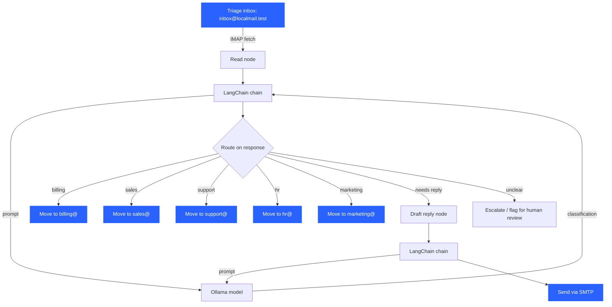

# Pipeline Overview

!!! info "Planned, not yet built"
    This page describes the intended architecture as discussed so far. The
    mail server (see [Mail Server](../mail-server/getting-started.md)) is
    built and verified; the pipeline itself is not yet implemented.

## Intended architecture

A [LangGraph](https://langchain-ai.github.io/langgraph/) graph drives the
flow:

1. A node reads mail over IMAP from the triage inbox (`inbox@localmail.test`).
2. That node invokes a [LangChain](https://www.langchain.com/) chain, which
   sends the message content to a local [Ollama](https://ollama.com/) model.
3. The model's response — e.g. a classification like "billing question" —
   determines which graph node runs next: moving the message to a
   department mailbox, drafting a reply, or escalating.
4. [LangSmith](https://www.langchain.com/langsmith) traces the run for
   debugging/evaluation.



Every node transition and every Ollama call is traced in LangSmith, so a
run can be replayed step by step when a classification looks wrong.

The mail server is purely the transport layer underneath all of this — the
pipeline talks to it over standard IMAP (read/move) and SMTP (send), the
same way any email client would. Nothing about LangGraph/LangChain/Ollama
changes how the mail server itself is configured.

## The classify-and-route pattern

This is the IMAP pattern a routing node should use to move a message from
the triage inbox into a department mailbox: fetch the raw message, classify
it, `APPEND` the untouched raw message into the destination mailbox, then
delete the original. This preserves the real MIME/header structure — the
message looks exactly like a normal email to whoever reads it next, which
matters for testing a pipeline against realistic data.

```python
import imaplib, ssl

ctx = ssl.create_default_context()
ctx.check_hostname = False
ctx.verify_mode = ssl.CERT_NONE  # self-signed cert, LAN testing only

# 1. Fetch the raw message from the triage inbox
src = imaplib.IMAP4('mail.localmail.test', 143)
src.starttls(ssl_context=ctx)
src.login('inbox@localmail.test', 'TestPass123!')
src.select('INBOX')
typ, data = src.search(None, 'ALL')
msg_id = data[0].split()[0]
typ, msg_data = src.fetch(msg_id, '(RFC822)')
raw_message = msg_data[0][1]

# 2. Classify — this is where the Ollama call plugs in
dest_user = 'billing@localmail.test'

# 3. Append the real, untouched message into the destination mailbox
dst = imaplib.IMAP4('mail.localmail.test', 143)
dst.starttls(ssl_context=ctx)
dst.login(dest_user, 'TestPass123!')
dst.append('INBOX', None, None, raw_message)
dst.logout()

# 4. Remove from the triage inbox (completes the "move")
src.store(msg_id, '+FLAGS', '\\Deleted')
src.expunge()
src.logout()
```

Verified end-to-end against the real mail server (both scripted via
`imaplib` and manually through the Roundcube webmail UI): message fetched
from `inbox@`, appended to a department mailbox, removed from the source —
confirmed on both ends.

## Writing a reply

Compose a MIME message (e.g. with Python's `email.message.EmailMessage`)
and send it via SMTP on port 587 with STARTTLS, same credentials as any
other authenticated send — see the `swaks` example in
[Getting Started](../mail-server/getting-started.md) for the equivalent raw
SMTP flow.
